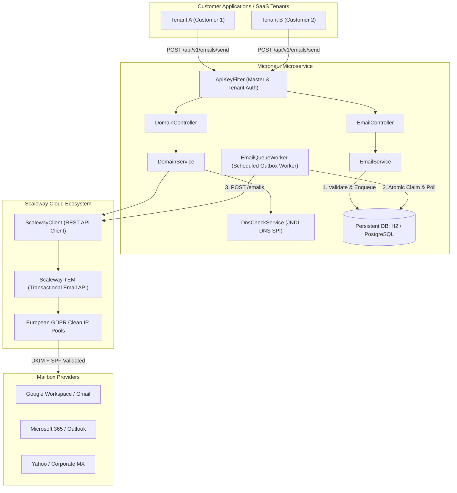
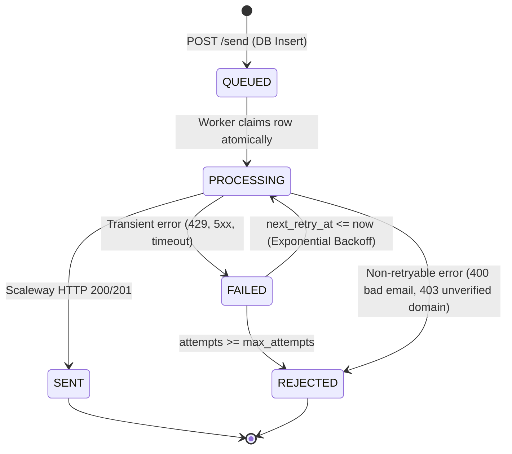

# Architecture & Reliability Design

This document details the architecture, multitenancy data isolation, and outbox reliability mechanisms of the **Scaleway TEM Mail Sending Microservice**.

---

## 1. High-Level Architecture Diagram

---

## 2. Multi-Tenancy & Data Isolation Model

1. **Service Operator Model**:
   - The microservice is operated on behalf of customer tenants. Customers do not possess or manage API keys.
   - Internal platform applications authenticate using a master service key (`X-Service-Key`, `X-API-Key`, or `Authorization: Bearer <key>`).
   - Requests specify the customer tenant via `tenantId`, or the service automatically resolves the tenant from the sender's registered domain (`from.email`).
2. **Domain Isolation**:
   - Sending domains are strictly partitioned by `tenant_id`.
   - Domains and outbound emails are tied to their respective tenant, preventing unauthorized cross-tenant sending.
3. **Quota Protection**:
   - Each tenant has an independent `daily_quota` to prevent any single customer from monopolizing sending capacity or incurring unexpected cloud bills.

---

## 3. Reliability & The Outbox Pattern

Direct synchronous HTTP calls to third-party email providers in user-facing request paths are brittle: network drops, temporary rate limits (HTTP 429), or cloud provider maintenance windows can cause silent email loss.

To guarantee zero email loss, this microservice implements the **Transactional Outbox Pattern**:

### Exponential Backoff with Jitter Formula

When a transient error occurs (such as Scaleway HTTP 429 or network timeout), the retry timestamp is calculated as:

$$\text{delay} = \min\left(\text{maxDelay}, \text{initialDelay} \times 2^{\text{attempt} - 1}\right) + \text{jitter}$$

- **Base delay:** 3s, 6s, 12s, 24s, 48s...
- **Jitter:** Random integer between 500ms and 2000ms to prevent the "thundering herd" problem when service recovers.
- **Max delay:** Capped at 300s (5 minutes).

### Idempotency Protection
Clients can submit an `Idempotency-Key` header with requests (e.g. `invoice-10492`). If a client network timeout occurs before receiving the HTTP response, the client can safely resend the same request:
- The microservice looks up `(tenant_id, idempotency_key)`.
- If found, it returns the existing queued/sent email immediately without double-sending to the customer.

---

## 4. Live DNS Pre-Verification Diagnostics

Before or alongside calling Scaleway's check endpoint, the microservice executes live DNS queries using the Java standard library's `InitialDirContext` (`com.sun.jndi.dns.DnsContextFactory`).

This inspects the world-visible DNS propagation:
- **SPF:** Verifies `v=spf1` contains `include:_spf.tem.scaleway.com`.
- **DKIM:** Verifies `scaleway._domainkey.<domain>` has `v=DKIM1;`.
- **DMARC:** Verifies `_dmarc.<domain>` has `v=DMARC1;`.
- **MX:** Checks for MX record presence.

The resulting diagnostic summary pinpoints exactly which DNS record is missing, misplaced, or mistyped.
